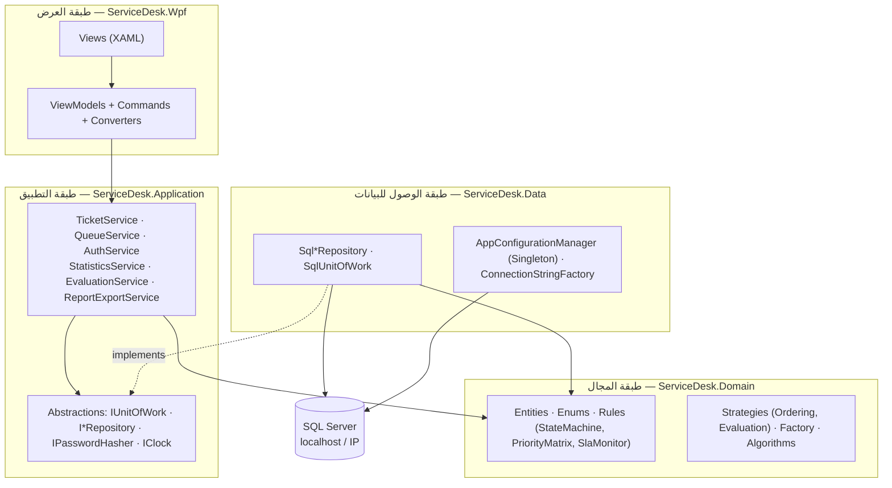
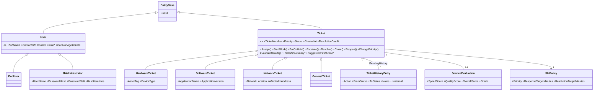
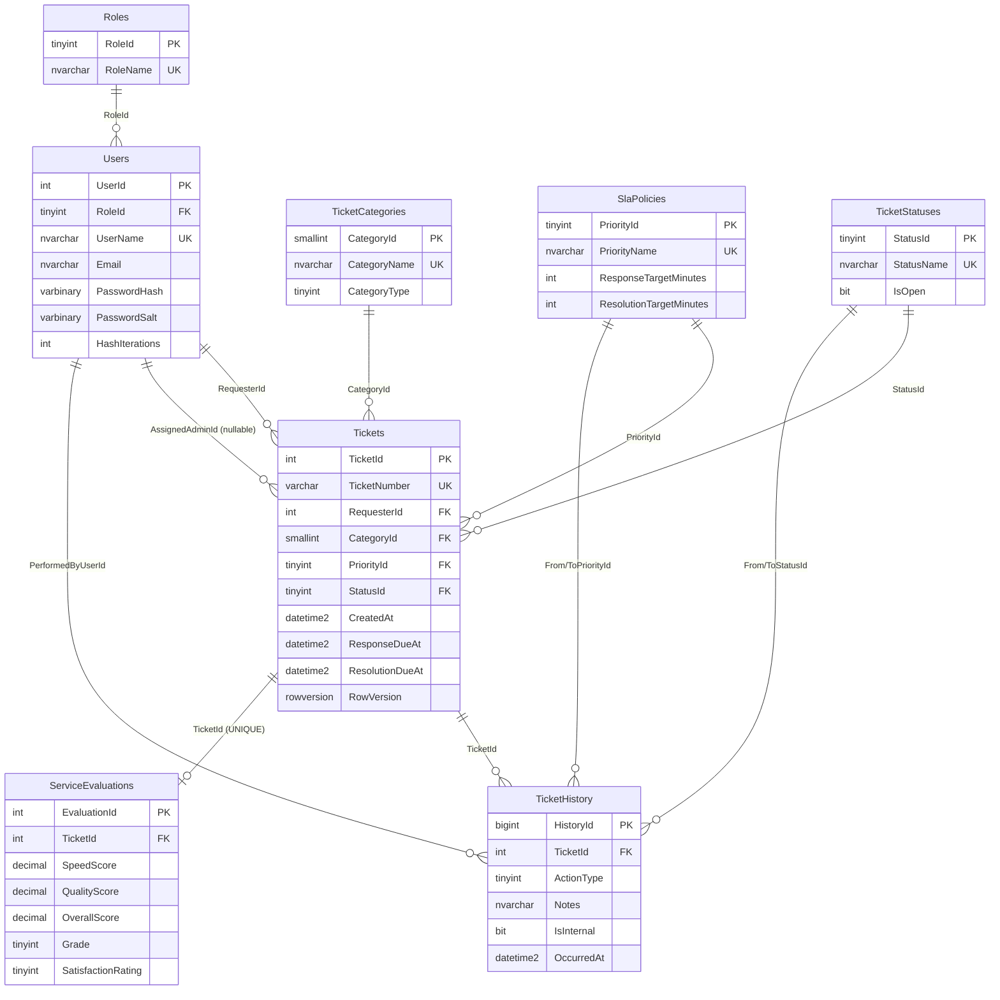
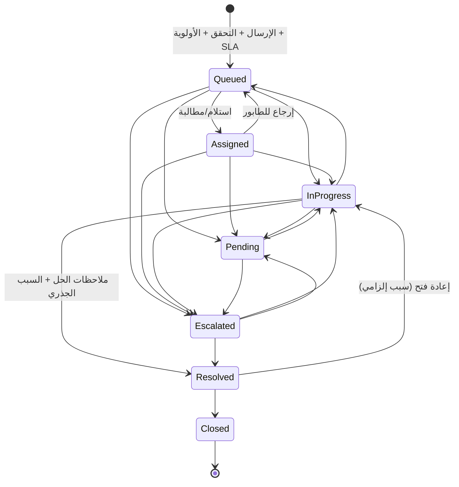

# وثيقة التصميم الهندسي — نظام إدارة تذاكر الدعم الفني (IT Service Desk)

> التقنيات: C# / .NET 8 · WPF (MVVM) · Microsoft SQL Server · ADO.NET (Microsoft.Data.SqlClient)
> المنهجية: معمارية طبقية (N-Tier) + تصميم موجّه بالمجال (Domain-centric) + إجراءات ITIL

---

## 1. المعمارية، نموذج البرمجة الكائنية، وأنماط التصميم

### 1.1 الطبقات واتجاه الاعتماديات

| الطبقة | المسؤولية | ما يُمنع فيها |
|---|---|---|
| العرض (WPF) | عرض البيانات، الربط (Binding)، الأوامر غير المتزامنة، المحوّلات | أي SQL أو قواعد أعمال؛ الـ code-behind يقتصر على تمرير `PasswordBox` |
| التطبيق | تنسيق حالات الاستخدام داخل وحدة عمل واحدة (معاملة)، الإحصاء، التقييم، التصدير | الاعتماد على WPF أو SqlClient |
| المجال | الكيانات، قواعد الانتقال بين الحالات، مصفوفة الأولوية، الخوارزميات، الاستراتيجيات | أي إدخال/إخراج (I/O) |
| الوصول للبيانات | استعلامات مُعاملة (Parameterized) فقط، بناء سلسلة الاتصال، حفظ الإعدادات مشفّرة | منطق أعمال |

**قاعدة الاعتماد:** المجال لا يعتمد على أي طبقة. واجهات المستودعات تُعرَّف في طبقة التطبيق، وتُنفَّذ في طبقة البيانات (عكس الاعتمادية — Dependency Inversion). جذر التركيب (Composition Root) موجود في `App.xaml.cs`.

### 1.2 نموذج الكائنات (OOP)

- **التغليف (Encapsulation):** كل الخصائص `internal set`؛ لا تتغير حالة التذكرة إلا عبر أساليب ذات دلالة (`Resolve`, `Escalate`…) تتحقق من القواعد وتُنشئ سجل تدقيق تلقائيًا. طبقة البيانات وحدها تستعيد الحالة عبر `InternalsVisibleTo`.
- **الوراثة:** `User → EndUser / ITAdministrator`، و`Ticket → Hardware / Software / Network / General`.
- **تعدد الأشكال (Polymorphism):** `ValidateDetails()` (نمط Template Method)، و`DetailsSummary`، و`SuggestedFirstAction`، و`CanManageTickets`.
- **الكائنات القيمية (Value Objects):** `ContactInfo` (سجل غير قابل للتعديل، يطبّع البريد الإلكتروني).

### 1.3 أنماط التصميم المطبّقة

| النمط | الموقع | الغرض |
|---|---|---|
| Repository | `I*Repository` ← `Sql*Repository` | عزل SQL عن منطق الأعمال |
| Unit of Work | `IUnitOfWork` ← `SqlUnitOfWork` | اتصال + معاملة واحدة تشترك فيها كل المستودعات؛ الإغلاق دون `Commit` = تراجع |
| Factory Method | `TicketFactory.CreateEmpty/CreateNew` | نوع الفئة (`CategoryType`) يحدد الصنف الفرعي للتذكرة (عند الإنشاء وعند القراءة من القاعدة) |
| Factory (اختيار المُنشئ) | `ConnectionStringFactory` + `LocalhostDataSourceBuilder` / `RemoteIpDataSourceBuilder` | بناء مصدر البيانات حسب مسار الاتصال، ثم `SqlConnectionStringBuilder` (لا دمج نصوص) |
| Strategy | `ITicketOrderingStrategy` (4 تطبيقات) و`IEvaluationStrategy` | ترتيب الطابور ومعادلة التقييم قابلة للاستبدال دون تعديل الخدمات |
| Observer | `INotifyPropertyChanged`، `ObservableCollection<T>`، حدث `TicketService.TicketChanged`، `AppConfigurationManager.SettingsChanged`، `DispatcherTimer` | تحديث الواجهة لحظيًا |
| Singleton | `AppConfigurationManager.Instance` (`Lazy<T>` بوضع `ExecutionAndPublication`) | مصدر وحيد آمن للخيوط لإعدادات الاتصال |
| State Machine | `TicketStateMachine` | منع الانتقالات غير المسموح بها |
| Template Method | `TicketService.ExecuteAsync` و`Ticket.Validate` | خطوات ثابتة (تحميل ← تحقق التزامن ← تعديل ← حفظ ← تدقيق ← تثبيت ← إشعار) |

---

## 2. مخطط الكيانات والعلاقات (ERD) ومخطط SQL Server

### 2.1 ERD

### 2.2 قرارات التطبيع (3NF)

- كل جدول بحث (`Roles`, `TicketStatuses`, `SlaPolicies`, `TicketCategories`) يحمل خصائص تعتمد على مفتاحه فقط؛ اسم الأولوية وأهداف الـ SLA تعتمد على `PriorityId` وحده.
- **عدادات إعادة الفتح والتصعيد والتعليق لا تُخزَّن** في `Tickets` لأنها مشتقة من `TicketHistory` (تخزينها يخلق اعتمادًا متعديًا وخطر عدم الاتساق)؛ تُحسب بتجميع SQL عند التقييم.
- `ResponseDueAt / ResolutionDueAt` تُخزَّن عمدًا (ليست مشتقة بالكامل): هي **التزام تعاقدي لحظة الإنشاء**؛ تعديل سياسة الـ SLA لاحقًا لا يغيّر التذاكر القائمة.
- `ServiceEvaluations` لقطة تاريخية (Snapshot) مع `FormulaVersion` لتتبع أي إصدار من المعادلة استُخدم.
- وراثة التذاكر مُمثَّلة بنمط **جدول واحد لكل التسلسل (TPH)**؛ الأعمدة الفرعية قابلة للقيمة الفارغة وتعتمد على المفتاح فقط، فيبقى الجدول في 3NF مع تجنّب عمليات JOIN إضافية.

### 2.3 القيود والفهارس الأساسية

- `CK_Users_Credentials`: المستخدم النهائي بلا بيانات اعتماد إطلاقًا، والمسؤول يجب أن يحمل الثلاثي الكامل (Hash, Salt, Iterations ≥ 100,000).
- `CK_Tickets_Dates`: تسلسل زمني منطقي (الإغلاق بعد الحل، الحل بعد الإنشاء…).
- `CK_Tickets_Resolution`: لا حلّ دون ملاحظات حل.
- `TR_TicketHistory_Immutable`: مُشغِّل `INSTEAD OF UPDATE, DELETE` يجعل سجل التدقيق للإلحاق فقط.
- `RowVersion`: تزامن تفاؤلي بين المسؤولين (التحديث مشروط بـ `WHERE RowVersion = @RowVersion`).
- `TicketNumber`: عمود محسوب `PERSISTED` بفهرس فريد ← بحث O(log N).
- `IX_Tickets_Queue (StatusId, PriorityId, ResolutionDueAt)`: يغطي استعلام الطابور.
- `READ_COMMITTED_SNAPSHOT ON`: تحديث الطابور لا يُقفل عمليات الفرز والمعالجة.

السكربت الكامل: `database/ServiceDesk_Setup.sql`.

### 2.4 منطق الاتصال المزدوج (Localhost + IP)

| المسار | الخيار | مصدر البيانات الناتج |
|---|---|---|
| Localhost | DefaultInstance | `localhost` |
| Localhost | NamedInstance | `.\SQLEXPRESS` |
| Localhost | LocalDb | `(localdb)\MSSQLLocalDB` |
| IP | IP + منفذ | `tcp:192.168.1.50,1433` |
| IP | IP + اسم مثيل (دون منفذ) | `192.168.1.50\INSTANCE` (يتطلب خدمة SQL Browser) |

- التحقق: `IPAddress.TryParse` للعنوان، والمنفذ بين 1 و65535، واسم القاعدة خالٍ من `; [ ] '`.
- سلسلة الاتصال تُبنى بـ `SqlConnectionStringBuilder` حصريًا (منع حقن خصائص الاتصال).
- **اختبار الاتصال** يفتح اتصالًا ويقرأ `SERVERPROPERTY` ويتحقق من وجود الجداول، ويترجم أرقام أخطاء SQL الشائعة (53 / 18456 / 4060 / 26 / الشهادة) إلى إرشادات عملية.
- الحفظ في `%AppData%\ServiceDesk\connection.json`، وكلمة مرور SQL مشفّرة بـ DPAPI (نطاق المستخدم الحالي)، والكتابة ذرّية (ملف مؤقت ثم `Move`).

---

## 3. الطابور والفرز وتحليل تعقيد الخوارزميات

### 3.1 بنية الطابور

1. **SQL** يرشّح التذاكر المفتوحة (فهرس `IX_Tickets_Queue`) ويعيد مجموعة بحجم k.
2. **الترتيب للعرض:** `MergeSort` مستقر مع مقارِن تُنتجه الاستراتيجية المختارة **للحظة زمنية ثابتة** (`CreateComparer(now)`)؛ تثبيت "الآن" ضروري لأن الدرجة تعتمد على الوقت، وتغيّرها أثناء الفرز يكسر شرط الترتيب الضعيف الصارم.
3. **"استلام التذكرة التالية":** كومة ثنائية صغرى (`BinaryHeapPriorityQueue`) تُبنى بخوارزمية Floyd، ثم `Dequeue` وإسناد؛ إن سبقك زميل (تعارض RowVersion) تُسحب التالية.
4. **فك التعادل:** كل استراتيجية تنتهي بـ `CreatedAt` ثم `TicketId` ← ترتيب كلّي حتمي.

### 3.2 استراتيجيات الترتيب

| الاستراتيجية | المعيار | متى تُستخدم |
|---|---|---|
| Weighted Urgency (افتراضية) | `Score = P + 0.6·S + A` | توازن بين الأولوية وضغط الـ SLA ومنع التجويع |
| Strict Priority | الأولوية ← أقرب موعد ← الأقدم | بيئات صارمة الأولوية |
| EDF | أقرب موعد حل أولًا | تقليل أسوأ تأخير (أمثل لخادم واحد) |
| FIFO | وقت الإرسال | خط أساس للعدالة والمقارنة |

حيث: `P` = وزن الأولوية (حرجة 100، عالية 70، متوسطة 40، منخفضة 10)، و`S = min(نسبة الوقت المستهلك من نافذة الحل, 1.5) × 100`، و`A = min(العمر بالساعات, 72) / 72 × 20`.
النتيجة: تذكرة "منخفضة" متجاوزة للـ SLA بشدة (≈ 120) يمكن أن تتقدم على "حرجة" جديدة (≈ 100) — وهذا مقصود لمنع التجويع، ومُثبت باختبار وحدة.

### 3.3 جدول التعقيد

| العملية | الأفضل | المتوسط | الأسوأ | المساحة | ملاحظة هندسية |
|---|---|---|---|---|---|
| مصفوفة الأولوية / فحص انتقال الحالة | O(1) | O(1) | O(1) | O(1) | جدول ثابت |
| بناء الكومة (Floyd) | O(n) | O(n) | O(n) | O(n) | مجموع الارتفاعات خطي |
| Enqueue في الكومة | O(1) | O(1) | O(log n) | O(1) | المتوسط ثابت لمدخلات عشوائية |
| Dequeue من الكومة | O(log n) | O(log n) | O(log n) | O(1) | |
| Peek | O(1) | O(1) | O(1) | O(1) | |
| Merge Sort (مع قطع Insertion عند 16) | O(n) | Θ(n log n) | Θ(n log n) | O(n) | الأفضل O(n) لمدخلات مرتبة بفضل فحص `a[mid] ≤ a[mid+1]`؛ مستقر |
| Quickselect (الوسيط، P90) | O(n) | O(n) | O(n²) | O(n) | محور عشوائي يجعل الأسوأ نادرًا جدًا |
| تجميع الإحصاءات (مرور واحد + Dictionary) | O(n) | O(n) | O(n²)* | O(n + g) | *تصادمات Hash نظرية؛ g = عدد المجموعات |
| فرز التفصيلات للعرض | O(g log g) | O(g log g) | O(g log g) | O(g) | g صغير جدًا |
| البحث برقم التذكرة | O(log N) | O(log N) | O(log N) | O(1) | فهرس فريد B-Tree |
| الترشيح بالحالة/الأولوية | O(log N + k) | O(log N + k) | O(N) | O(k) | Index Seek؛ الأسوأ عند `OPTION(RECOMPILE)` مع مسح |
| البحث النصي `LIKE '%x%'` | O(N·m) | O(N·m) | O(N·m) | O(k) | يتطلب مسحًا؛ البديل: Full-Text Index |
| تقييم تذكرة واحدة | O(h) | O(h) | O(h) | O(1) | h = عدد سجلات التدقيق للتذكرة |
| التحقق من كلمة المرور | Θ(I) | Θ(I) | Θ(I) | O(1) | I = 600,000 تكرار — بطء مقصود ضد التخمين |

**لماذا Merge Sort وليس Quick Sort؟** الاستقرار (التذاكر المتساوية تحافظ على ترتيبها بين التحديثات فلا "تقفز" في الشاشة)، وضمان Θ(n log n) في أسوأ الحالات، وحجم الطابور (آلاف) يجعل كلفة O(n) ذاكرة مهملة.
**لماذا الكومة لـ"استلام التالي"؟** نحتاج العنصر الأعلى فقط مع احتمال تكرار المحاولة عند التعارض: البناء O(n) + سحب O(log n) لكل محاولة أفضل من فرز كامل O(n log n).

---

## 4. الإحصاءات ومعادلات تقييم الخدمة

### 4.1 الإحصاءات

- **العدّ:** الإجمالي، المفتوح (قيد التنفيذ / معلّق)، المحلول/المغلق، المفتوح المتجاوز، المفتوح المعرّض للخطر (≥ 75% من نافذة الـ SLA)، والتوزيع حسب الفئة والأولوية والمسؤول والحالة والتقدير.
- **زمن الحل** `Dᵢ = ResolvedAtᵢ − CreatedAtᵢ` (بالساعات):
  - المتوسط `μ = ΣDᵢ / n`
  - الوسيط عبر Quickselect (متوسط العنصرين الأوسطين عند n زوجي)
  - الحد الأدنى والأقصى، الانحراف المعياري للمجتمع `σ = √(Σ(Dᵢ − μ)² / n)`، والمئين التسعون (أقرب رتبة: العنصر ⌈0.9n⌉)
- **الالتزام بالـ SLA:** `SLA% = 100 × |{ResolvedAt ≤ ResolutionDueAt}| / |{Resolved}|`، ومثله للاستجابة الأولى.

### 4.2 تقييم التذكرة (الإصدار v1)

| المكوّن | المعادلة |
|---|---|
| نسبة السرعة | `r = زمن الحل الفعلي / زمن الحل المستهدف` |
| **Speed** | `100` إذا r ≤ 0.5 · `100 − 80(r − 0.5)` إذا 0.5 < r ≤ 1 · `max(0, 60 − 60(r − 1))` إذا r > 1 |
| نسبة الاستجابة | `q = زمن أول استلام / هدف الاستجابة` |
| Response | `100` إذا q ≤ 1 · وإلا `max(0, 100 − 50(q − 1))` |
| Discipline (انضباط المسار) | `max(0, 100 − 20·Reopens − 10·Escalations − 5·max(0, Pendings − 1))` |
| Satisfaction (اختياري) | `(Rating − 1) / 4 × 100` |
| **Quality** | `(0.4·Response + 0.3·Discipline + 0.3·Satisfaction) / 1.0` — وعند غياب التقييم يُعاد التطبيع: `(0.4·Response + 0.3·Discipline) / 0.7` |
| **Overall** | `0.6·Speed + 0.4·Quality` |
| **Grade** | `SLA Breached` إذا ResolvedAt > ResolutionDueAt (يتقدّم على الدرجة)، وإلا: ممتاز ≥ 85، جيد ≥ 70، مقبول ≥ 50، ضعيف < 50 |

مثال تحقق (موجود كاختبار وحدة): حل بعد 10 ساعات لهدف 8 ساعات، استجابة بعد ساعتين لهدف 30 دقيقة، إعادة فتح واحدة، تصعيد واحد، تعليقان ← Speed = 45، Response = 0، Discipline = 65، Quality ≈ 27.9، Overall ≈ 38.1، التقدير = SLA Breached.

### 4.3 مؤشر صحة الخدمة

`Health = 0.5·SLA% + 0.3·mean(Overall) + 0.2·(100 − نسبة المفتوح المتجاوز)`
التصنيف: سليم ≥ 85، مستقر ≥ 70، يحتاج انتباهًا ≥ 50، حرج < 50.
الأوزان قابلة للضبط عبر `EvaluationWeights` دون تعديل الكود المستهلك (نمط Strategy).

---

## 5. دورة حياة التذكرة (ITIL)

كل انتقال: يُتحقق منه في `TicketStateMachine` ← يُسجَّل في `TicketHistory` داخل نفس المعاملة ← أول خروج من `Queued` يثبّت `FirstResponseAt` ← الحل يطلق التقييم فورًا ← تغيير الأولوية يعيد حساب المواعيد **من وقت الإنشاء** (فلا يمكن "تصفير" تجاوز قائم).

---

## 6. الأمان وجودة المدخلات

- استعلامات مُعاملة 100% بأنواع وأطوال صريحة (`SqlDbType`, `Size`)، وهروب محارف `LIKE` (`% _ [ \`).
- PBKDF2-HMAC-SHA256، ملح 128 بت، مفتاح 256 بت، 600,000 تكرار، مقارنة بزمن ثابت (`FixedTimeEquals`)، ورسالة خطأ عامة لا تكشف وجود اسم المستخدم.
- حماية من التخمين: قفل 60 ثانية بعد 5 محاولات فاشلة (في الذاكرة).
- تتبّع التذكرة يتطلب **الرقم + البريد معًا** لمنع تعداد التذاكر؛ الملاحظات الداخلية تُستبعد على مستوى SQL.
- التصدير إلى CSV محمي من حقن الصيغ (`= + - @`) ومتوافق مع RFC 4180.
- تزامن تفاؤلي عبر `ROWVERSION` يمنع الكتابة الصامتة فوق عمل مسؤول آخر.
